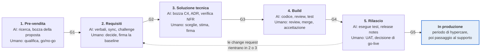

# Playbook: Panoramica del ciclo di vita della delivery

*7 nov 2026 · @gp*

Un unico flusso dalla prima conversazione con il cliente fino al rilascio in produzione, con l'AI che redige e le persone che decidono a ogni passo: le Vendite qualificano l'opportunità e consegnano un discovery pack all'Analisi, l'Analisi firma una baseline dei requisiti, l'Architettura firma una soluzione tecnica, l'Engineering la realizza, e QA e Release la rilasciano. Ogni fase si chiude con un gate con approvatori nominati e un unico artefatto di consegna, così nulla di ciò che il cliente ci ha già detto viene richiesto di nuovo.

**Ambito.** Dal primo contatto con un prospect fino al rilascio in produzione e all'hypercare. Questo documento definisce a cosa serve ogni fase, chi decide e cosa passa alla fase successiva. Ogni fase ha un proprio playbook di dettaglio;

## Ruoli e strumenti

Ogni fase ha un ruolo responsabile; lo sponsor del cliente è titolare delle decisioni di business per tutto il percorso.

| Fase | Responsabile della fase | Firma il gate | Contribuisce |
|---|---|---|---|
| 1. Pre-vendita | Account executive | Sales lead, delivery lead, cliente (contratto) | Sales engineer, solution architect a chiamata |
| 2. Requisiti e analisi | Business analyst (BA) | Sponsor del cliente, tech lead | Product owner, esperti di dominio (SME), utenti finali |
| 3. Soluzione tecnica | Solution architect | Tech lead, sponsor del cliente (costi), IT e security del cliente | BA, DevOps, security |
| 4. Build | Tech lead | Product owner (accettazione delle story) | Sviluppatori, BA, QA |
| 5. Rilascio | QA lead e release manager | Sponsor del cliente (UAT), tech lead, operations (go-live) | Sviluppatori, DevOps, utenti chiave, supporto |
| Tutte le fasi | Claude (assistente AI) | Non firma mai | Estrae, redige, verifica e mette in discussione; scrive solo con consenso esplicito |

## Panoramica delle fasi

**Cinque fasi, cinque gate: ognuno consegna un artefatto firmato al successivo**

> G1 opportunità vinta, SOW firmato · G2 baseline dei requisiti firmata · G3 soluzione tecnica firmata · G4 release candidate in staging · G5 UAT firmato, go-live approvato

*Ciclo di vita della delivery · 5 fasi, 5 gate, 1 ciclo di modifica*

Ogni fase parte dall'artefatto del gate precedente; dopo la baseline, ogni change request rientra in Requisiti, oppure in Soluzione tecnica quando tocca l'architettura.

## Processo fase per fase

Cinque fasi. In ognuna, AI e strumenti redigono e verificano, un responsabile umano nominato decide, e un artefatto supera il gate verso la fase successiva.

### 1. Pre-vendita

**Obiettivo:** qualificare l'opportunità, delineare una prima soluzione e un prezzo, e vincere il contratto senza perdere ciò che il cliente ci ha detto.

| Chi | Cosa fa |
|---|---|
| AI e strumenti | Teams registra le call di discovery (con consenso); lo strumento per le note delle riunioni le trascrive. Claude riassume l'RFP o il brief da SharePoint, ricerca il contesto pubblico del cliente, legge il codice o la documentazione esistenti quando il cliente li condivide, e redige le note di discovery (obiettivi, criticità, utenti, sistemi, vincoli, segnali su budget e tempistiche), una prima lista delle funzionalità dentro e fuori ambito, ipotesi, rischi, la proposta e una stima di ordine di grandezza. Claude Design può simulare due o tre schermate quando un elemento visivo aiuta la presentazione. |
| Umano (account executive, sales engineer) | Conduce la discovery e qualifica l'opportunità. Decide cosa viene promesso. Il sales engineer verifica fattibilità e stima, insieme a un solution architect quando l'ambito è insolito. Ogni ipotesi nella proposta è etichettata come ipotesi. |
| Umano (sales lead, delivery lead) | Go / no-go sulla partecipazione alla gara. Approva prezzo, ambito e staffing prima dell'invio della proposta. |
| Passa alla fase 2 | Discovery pack: SOW o contratto firmato, proposta, verbali di discovery, lista delle funzionalità, ipotesi, rischi, elenco degli stakeholder, stima e relative basi. Consegnato in un kick-off interno alla presenza del BA. |

### 2. Raccolta e analisi dei requisiti

**Obiettivo:** una baseline dei requisiti firmata, composta da requisiti funzionali testabili e non funzionali misurabili, ciascuno con la propria evidenza. Dettagliata nel *Playbook: Raccolta e analisi dei requisiti (assistita da AI)*.

| Chi | Cosa fa |
|---|---|
| AI e strumenti | Claude inizializza la pagina dei requisiti su Confluence a partire dal discovery pack, redige i verbali dalle sessioni registrate, esegue il sync dei requisiti tra Teams, Jira, SharePoint e GitHub, mette in discussione l'insieme dei requisiti e propone criteri di accettazione e diagrammi. Claude Design prototipa i flussi Must-have e Should-have. |
| Umano (BA, sponsor, tech lead) | Il BA conduce l'elicitazione e decide su ogni modifica proposta e ogni challenge. Lo sponsor stabilisce le priorità MoSCoW e risolve i conflitti. Il tech lead verifica la fattibilità e conferma i target degli NFR. |
| Passa alla fase 3 | Baseline firmata (versione, data, firmatari), prototipo approvato, registro delle decisioni, domande aperte con un responsabile, bozze delle epic Jira. Ogni scostamento rispetto al SOW viene sollevato come change request. |

### 3. Soluzione tecnica

**Obiettivo:** decidere come il sistema sarà costruito e gestito, e dimostrare che soddisfa gli NFR entro il budget concordato.

| Chi | Cosa fa |
|---|---|
| AI e strumenti | Claude legge la baseline, gli NFR, il codice esistente e i vincoli del cliente, e redige come pull request su GitHub: la panoramica dell'architettura (C4 di contesto e di container), le specifiche di integrazione, il modello dati (ERD), gli ADR con opzioni e trade-off, le note su sicurezza e protezione dei dati, gli ambienti e lo schema della CI/CD, e una stima raffinata per epic. Verifica che ogni requisito Must-have e ogni NFR sia associato a un componente o a una decisione. |
| Umano (solution architect, tech lead) | L'architect sceglie tra le opzioni ed è titolare di ogni ADR. Il tech lead conferma realizzabilità, standard e stima. IT e security del cliente esaminano hosting, integrazioni e gestione dei dati. |
| Umano (sponsor, delivery lead) | Approvano la stima raffinata e il piano di rilascio. Tutto ciò che va oltre il SOW passa dal change control. |
| Passa alla fase 4 | Soluzione firmata: documenti di architettura e ADR in merge, stack tecnologico e standard, Definition of Ready e Done, piano di rilascio, backlog Jira pronto per il primo sprint. |

### 4. Build

**Obiettivo:** trasformare le story pronte in codice revisionato, testato e in merge, coerente con la baseline e con l'architettura.

| Chi | Cosa fa |
|---|---|
| AI e strumenti | Claude assiste gli sviluppatori su GitHub: redige codice e unit test a partire da story e criteri di accettazione, revisiona le pull request rispetto ad ADR, standard e ID dei requisiti, mantiene la documentazione allineata al codice e segnala il lavoro che si discosta dalla baseline. La CI esegue build, test, analisi statica e scansioni di sicurezza su ogni pull request. |
| Umano (sviluppatori, tech lead) | Gli sviluppatori sono responsabili di ogni riga che portano in merge; un umano approva ogni pull request. Il tech lead presidia architettura e standard. |
| Umano (product owner, BA) | Sprint review e demo. Accettano le story in base ai criteri di accettazione. Il BA instrada le nuove esigenze attraverso la classificazione delle modifiche. |
| Passa alla fase 5 | Release candidate: story Done secondo la Definition of Done, CI verde, rilasciata in staging, bozza delle release notes, elenco dei problemi noti. |

### 5. Rilascio

**Obiettivo:** dimostrare che la release funziona per utenti e operatori, poi metterla in produzione in sicurezza e consegnarla al supporto.

| Chi | Cosa fa |
|---|---|
| AI e strumenti | Claude ricava i casi di test dai criteri di accettazione e dai target degli NFR e li associa agli ID dei requisiti, redige i piani di test di regressione, prestazioni e sicurezza, fa il triage delle esecuzioni fallite e dei bug in Jira, e redige release notes, runbook, piano di rollback e guide utente. |
| Umano (QA lead, tester) | Eseguono test di sistema, integrazione, regressione, prestazioni e sicurezza. Stabiliscono la severità dei bug. Confermano i criteri di uscita dei test. |
| Umano (sponsor, utenti chiave) | Eseguono lo user acceptance testing in staging e lo firmano. |
| Umano (tech lead, operations, release manager) | Go / no-go per la produzione, deploy, monitoraggio dell'hypercare, passaggio al supporto. |
| Passa oltre | Release in produzione, UAT firmato, release notes, runbook, matrice di tracciabilità. I problemi emersi durante l'hypercare entrano in Jira e nel ciclo di modifica. |

## Gate e consegne

Una fase è chiusa solo quando i criteri di uscita del suo gate sono soddisfatti e gli approvatori hanno firmato; Claude prepara il pacchetto del gate, le persone lo firmano.

| Gate | Chiude | Criteri di uscita | Approvatori | Artefatto di consegna |
|---|---|---|---|---|
| G1 | 1. Pre-vendita | Decisione di go; SOW firmato; ipotesi ed elementi fuori ambito elencati | Sales lead, delivery lead, cliente | Discovery pack |
| G2 | 2. Requisiti | Nessun conflitto irrisolto; ogni domanda aperta ha un responsabile e una data; baseline firmata | Sponsor del cliente, tech lead | Baseline dei requisiti e prototipo approvato |
| G3 | 3. Soluzione tecnica | Ogni Must-have e NFR associato a un componente o a un ADR; stima entro il SOW o change request approvata | Solution architect, tech lead, sponsor del cliente | Pacchetto di architettura e backlog pronto |
| G4 | 4. Build | Story Done; CI verde; nessun bug critico aperto; rilasciato in staging | Tech lead, product owner | Release candidate |
| G5 | 5. Rilascio | Criteri di uscita dei test soddisfatti; UAT firmato; piano di rollback pronto | Sponsor del cliente, tech lead, operations | Release in produzione |

## Diagrammi come codice

| Domanda del lettore | Notazione | Strumento |
|---|---|---|
| Chi fa cosa, con approvazioni ed eccezioni | BPMN 2.0 | bpmn.io |
| Chi chiama chi, e in quale ordine | Mermaid sequence | Lucid / draw |
| Ciclo di vita di un singolo oggetto (spedizione, reclamo) | Mermaid state | Lucid / draw |
| Entità e relazioni | Mermaid ER | Lucid / draw |
| Flusso di passi semplice | Mermaid flowchart | Lucid / draw |
| Contesto del sistema e integrazioni | Mermaid flowchart con subgraph | Lucid / draw |

## Documenti

| Tipo di documento | Adottato | Posizione |
|---|---|---|
| **Prodotto e business** | | |
| **Visione e obiettivi del prodotto**: definizione del problema, utenti target, metriche di successo/KPI, cosa è esplicitamente fuori ambito. | Sì | Es. Confluence |
| **Mappa degli stakeholder**: chi decide cosa, sponsor, SME, approvatori per ambito, budget e scelte tecniche. | | |
| **Personas e ruoli utente**: inclusi i livelli di permesso, se i ruoli determinano il controllo degli accessi. | | |
| **Roadmap e piano di rilascio**: fase attuale, milestone, MVP rispetto alle fasi successive. | | |
| | | |
| **Requisiti** | | |
| **Documento dei requisiti / PRD**: requisiti funzionali con ID, priorità e stato. | | |
| **Requisiti non funzionali**: prestazioni, sicurezza, disponibilità, conformità (es. GDPR), accessibilità, conservazione dei dati. | | |
| **Regole di business**: calcoli, validazioni, policy, casi limite. | | |
| **Flussi di processo**: as-is e to-be (sorgente BPMN o Mermaid). | | |
| **Registro delle decisioni**: data, decisione, chi ha deciso, motivazione, ID dei requisiti collegati. | | |
| **Registro delle domande aperte e delle ipotesi**. | | |
| | | |
| **Architettura** | | |
| **Panoramica dell'architettura**: diagrammi C4 di contesto e di container, componenti principali, hosting/cloud. | | Es. repository GitHub |
| **ADR**: un documento ciascuno o un registro unico. | | |
| **Stack tecnologico e standard**: linguaggi, framework, convenzioni API (REST/GraphQL, versioning, formato degli errori), standard di codifica e di naming. | | |
| **Integrazioni**: sistemi esterni, protocolli, metodo di autenticazione, titolari dei dati, SLA. | | |
| **Modello dati**: entità chiave e relazioni (ERD), titolarità dei dati, campi sensibili. | | |
| **Vincoli**: budget, sistemi legacy da mantenere, normativa, competenze del team. | | |
| | | |
| **Convenzioni di lavoro** | | |
| **Glossario**: termini di dominio, acronimi, nomi in codice. | | |
| **Definition of Ready / Definition of Done**. | | |
| **Template**: i formati preferiti per story, epic, ADR e specifiche, più un *buon esempio* di ciascuno. Gli esempi insegnano il formato meglio delle descrizioni. | | |
| **Mappa degli strumenti**: es. "I requisiti stanno nel ClickUp Doc X; le decisioni si prendono in #project-channel; le riunioni sono registrate in Fathom; i diagrammi stanno in Lucid." | | |
