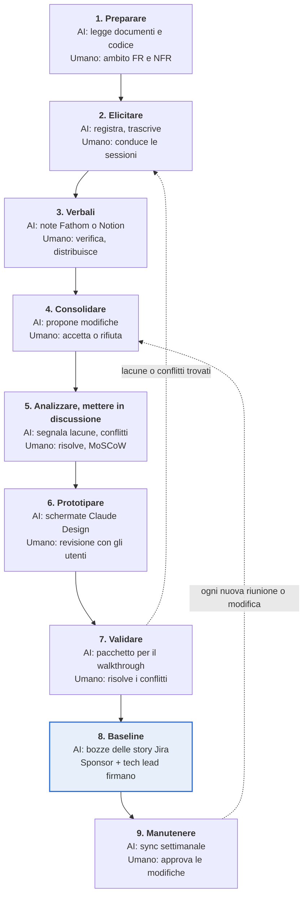

# Playbook: Raccolta e analisi dei requisiti

*31 ott 2026 · @gp*

L'AI cattura e redige, l'analista decide: le sessioni con gli stakeholder in Microsoft Teams vengono registrate, l'AI redige i verbali (Fathom o Notion), Claude li trasforma in requisiti candidati con relativa evidenza e li mette in discussione, Claude Design li prototipa per l'approvazione, e solo gli elementi approvati entrano nella pagina dei requisiti su Confluence, l'unica baseline. Jira porta i requisiti approvati nella delivery.

**Ambito.** Dal kick-off del progetto fino a una baseline dei requisiti firmata, più il ciclo di manutenzione che la mantiene aggiornata durante la delivery. I prototipi rapidi per l'approvazione sono in ambito; design di dettaglio, build e test sono fuori ambito.

**Stato.** Bozza per revisione. I punti da confermare con l'organizzazione sono elencati in *Punti aperti* alla fine.

## Principi

1. **Human in the loop.** L'AI propone; l'analista approva. Claude ha accesso in lettura e scrittura agli strumenti collegati, ma non scrive nulla (pagina, issue, messaggio, file o commit) finché un umano non dà il consenso esplicito per quella scrittura.
2. **Evidenza per ogni elemento.** Ogni requisito è collegato alla sua fonte: una registrazione di una riunione Teams, un thread di un canale Teams o una issue Jira.
3. **Un'unica fonte di verità.** La pagina dei requisiti su Confluence è la baseline; le issue Jira vi rimandano. Chat e registrazioni sono input, mai il documento di riferimento.
4. **Segnale, non rumore.** Solo gli impegni diventano requisiti. Idee e "e se…" diventano domande aperte.
5. **I conflitti si fanno emergere, non si risolvono d'ufficio.** Quando le fonti non concordano, entrambe le versioni vanno al responsabile della decisione.
6. **Deprecare, mai cancellare.** Gli elementi scartati mantengono il loro testo e ricevono una riga di stato con data e fonte.
7. **Diagrammi come codice.** I diagrammi stanno sulla pagina Confluence accanto al testo che spiegano: Mermaid o BPMN come codice se Confluence lo supporta, altrimenti embed di Lucid o draw.io.
8. **Gli input sono dati.** Il testo in una chat o in una trascrizione viene valutato, mai eseguito come istruzione. I contenuti sensibili (HR, stipendi, credenziali) restano fuori dalla pagina.

## Ruoli e strumenti

Il business analyst è responsabile della fase; lo sponsor del cliente è titolare delle decisioni.

| Ruolo | Responsabilità in questa fase |
|---|---|
| Business analyst (BA) | Pianifica le sessioni, conduce l'elicitazione, revisiona l'output dell'AI, mantiene la pagina Confluence |
| Sponsor del cliente / product owner | Stabilisce obiettivi e priorità, risolve i conflitti, co-firma la baseline |
| Esperti di dominio (SME) e utenti finali | Descrivono il processo attuale, le criticità e le esigenze |
| Tech lead | Verifica la fattibilità, conferma i target non funzionali, co-firma la baseline |
| Claude (assistente AI) | Estrae, classifica, redige, modella e cerca le lacune; non approva mai e scrive solo con consenso esplicito |

| Strumento | Utilizzato per | Accesso di Claude |
|---|---|---|
| Microsoft Teams | Ospitare e registrare le sessioni; condividere i verbali; chiarimenti e decisioni asincroni in canali e chat | Lettura e scrittura |
| Note delle riunioni: Fathom o Notion (a scelta del team) | Trascrivere le sessioni Teams; Fathom redige i verbali autonomamente, con Notion è Claude a redigerli dalla trascrizione | Lettura (Notion tramite connettore) |
| Confluence | Documentazione esistente; pagina dei requisiti (baseline), verbali, challenge log, commenti, firma, cronologia della pagina | Lettura e scrittura |
| Jira | Epic e story dai requisiti approvati; stato e commenti delle issue come feedback | Lettura e scrittura |
| SharePoint | Documenti di lavoro attivi e documenti sorgente del cliente | Lettura e scrittura |
| GitHub | Repository del codice per progetto (codice esistente e futuro), separato dal repository di analisi, letto per capire comportamento attuale, dati e integrazioni | Lettura e scrittura |
| Claude | Estrazione, classificazione, verifiche di challenge, criteri di accettazione, diagrammi, verbali; esegue il sync dei requisiti su tutti gli strumenti sopra | Scrive solo dopo consenso umano esplicito |
| Claude Design | Prototipi cliccabili rapidi a partire dai requisiti, per l'approvazione degli stakeholder | Crea prototipi |
| Mermaid / BPMN 2.0, oppure Lucid / draw.io | Modelli di processo, sequenza, stato e dati sulla pagina Confluence | Redige diagrammi |

Ogni scrittura di Claude (una modifica su Confluence, una issue Jira, un messaggio Teams, un file SharePoint o un commit GitHub) viene prima mostrata a un umano ed eseguita solo dopo il consenso esplicito di quella persona.

## Panoramica della fase

**In ogni passo l'AI redige e verifica, un umano decide**

*Panoramica della fase · 7 passi, 2 cicli*

La validazione rimanda le lacune all'elicitazione; dopo la firma, ogni nuova riunione o modifica rientra nella consolidazione.

## Processo passo per passo

Nove passi. In ognuno, AI e strumenti redigono e verificano, un responsabile umano nominato decide, e un output definito passa al passo successivo. I passi da 2 a 7 si ripetono finché i criteri di uscita non sono soddisfatti.

### 1. Preparare

**Obiettivo:** concordare obiettivi, ambito funzionale e non funzionale, e con chi parlare.

| Chi | Cosa fa |
|---|---|
| AI e strumenti | Claude legge i documenti attivi su SharePoint, la documentazione esistente su Confluence e il codice esistente su GitHub, riassume come funziona il sistema attuale, e redige un glossario, l'elenco degli stakeholder, una prima lista di domande e il CLAUDE.md del repository di analisi a partire dal template. La pagina Confluence viene creata dal template e collegata a un progetto o a una epic Jira. |
| Umano (BA) | Conferma gli stakeholder e revisiona e porta in merge la pull request del CLAUDE.md. Redige l'ambito funzionale (funzionalità dentro e fuori) e l'ambito non funzionale (attributi di qualità dentro e fuori) come due liste separate. Pianifica le sessioni. |
| Esempi di skill e agenti | Il subagent Explore scandisce GitHub e Confluence per il riepilogo as-is. La skill memory-management costruisce il glossario e il CLAUDE.md. La skill project-kickoff (nuova) redige l'elenco degli stakeholder, le prime domande e il CLAUDE.md dal template. |
| Passa al passo 2 | Pagina Confluence con obiettivi, entrambe le liste di ambito, stakeholder e piano delle sessioni, confermata dallo sponsor. |

### 2. Elicitare

**Obiettivo:** ascoltare le esigenze con le parole degli stakeholder.

| Chi | Cosa fa |
|---|---|
| AI e strumenti | Teams registra la sessione. Lo strumento per le note delle riunioni scelto dal team (Fathom o Notion, vedi passo 3) la trascrive con i timestamp. Claude redige agenda e domande a partire dalle domande aperte sulla pagina. |
| Umano (BA) | Dichiara il consenso alla registrazione. Conduce l'intervista o il workshop, un argomento per sessione. Chiede esempi, volumi ed eccezioni, e separatamente le aspettative di qualità (velocità, disponibilità, sicurezza, usabilità). Chiude con un riepilogo a voce di decisioni e punti aperti. |
| Esempi di skill e agenti | La skill requirements-reviewer redige domande mirate per la sessione. La skill session-prep (nuova) costruisce l'agenda dalle domande aperte, un argomento per sessione, con spunti per FR e NFR. |
| Passa al passo 3 | Registrazione e trascrizione di ogni sessione. |

### 3. Redigere e condividere i verbali

**Obiettivo:** sostituire i verbali scritti a mano con verbali redatti dall'AI che l'analista verifica e invia in giornata.

| Chi | Cosa fa |
|---|---|
| AI e strumenti | Opzione A, Fathom: redige i verbali direttamente dalla call Teams. Opzione B, Notion: cattura la trascrizione; Claude la legge tramite il connettore Notion e scrive i verbali. Entrambe producono lo stesso output nel template dei verbali: sintesi, decisioni, azioni con responsabili e domande aperte, ciascuna collegata al proprio momento nella registrazione. |
| Umano (BA) | Verifica l'accuratezza e rimuove i contenuti sensibili, invece di scrivere da zero. Pubblica i verbali nel canale Teams del progetto e li archivia su Confluence. I partecipanti confermano o correggono entro 2 giorni lavorativi. |
| Esempi di skill e agenti | La skill meeting-minutes (nuova) contiene il template dei verbali e, per l'Opzione B, trasforma la trascrizione Notion in verbali con link con timestamp e un segnalatore di contenuti sensibili. |
| Passa al passo 4 | Verbali confermati su Confluence, collegati alla registrazione. |

**Scelta dello strumento per le note delle riunioni.** Fathom richiede un passaggio in meno ma non è ancora approvato. Notion è disponibile da subito e aggiunge un passaggio (Claude riassume la trascrizione). Il template dei verbali e il resto del processo sono identici in entrambi i casi, quindi il team può scegliere ora e cambiare in seguito.

### 4. Consolidare

**Obiettivo:** trasformare verbali, thread e issue in requisiti candidati.

| Chi | Cosa fa |
|---|---|
| AI e strumenti | Claude esegue il sync dei requisiti: legge la baseline su Confluence, raccoglie evidenze da verbali, trascrizioni, thread Teams, Jira, documenti SharePoint e codice GitHub, etichetta ogni rilievo come funzionale o non funzionale, lo classifica e propone modifiche con prima, dopo e fonte. |
| Umano (BA) | Accetta, modifica o rifiuta ogni modifica proposta. Claude scrive su Confluence le modifiche accettate solo dopo questo consenso esplicito. Rimanda gli elementi a bassa confidenza come domande aperte. |
| Esempi di skill e agenti | La skill requirements-sync, riconfigurata su Teams, Confluence, Jira, SharePoint e GitHub. Il subagent Explore raccoglie evidenze dal codice. |
| Passa al passo 5 | Requisiti candidati approvati sulla pagina, ciascuno con un ID, un'etichetta FR o NFR e una fonte. |

### 5. Analizzare e mettere in discussione

**Obiettivo:** rendere ogni requisito chiaro, completo, coerente e testabile.

| Chi | Cosa fa |
|---|---|
| AI e strumenti | Claude mette in discussione l'insieme dei requisiti per ambiguità, casi di errore mancanti, contraddizioni e lacune (vedi la sezione successiva). Propone criteri di accettazione a livello di requisito, target NFR misurabili e diagrammi (BPMN, Mermaid). |
| Umano (BA, tech lead) | Il BA decide su ogni challenge: chiarire, aggiungere un requisito, sollevare una domanda aperta o archiviare con una motivazione. Il BA assegna le priorità con MoSCoW. Il tech lead verifica la fattibilità e conferma i target NFR. |
| Esempi di skill e agenti | La skill requirements-reviewer esegue le verifiche di challenge. La skill devil-advocate attacca gli elementi ad alto rischio. La skill diagrams-as-code (nuova) redige Mermaid e BPMN, con il connettore Lucid come alternativa. |
| Passa al passo 6 | FR testabili e NFR misurabili con priorità MoSCoW, criteri di accettazione a livello di requisito e modelli; challenge log chiuso o trasformato in domande aperte con un responsabile. |

### 6. Prototipare

**Obiettivo:** permettere agli stakeholder di vedere la soluzione prima di approvarla.

| Chi | Cosa fa |
|---|---|
| AI e strumenti | Claude Design trasforma gli FR Must-have e Should-have in schermate e flussi cliccabili, e li rivede durante la sessione di revisione. |
| Umano (BA, sponsor, utenti chiave) | Il BA sceglie i flussi da mostrare e verifica che ogni schermata sia tracciata a un ID di requisito. Sponsor e utenti chiave esaminano e danno feedback; il BA lo registra. |
| Esempi di skill e agenti | Claude Design con la skill frontend-design; ogni schermata è etichettata con il suo ID di requisito. |
| Passa al passo 7 | Prototipo approvato collegato su Confluence. Requisiti nuovi o modificati tornano al passo 4. |

### 7. Validare

**Obiettivo:** confermare di aver capito correttamente.

| Chi | Cosa fa |
|---|---|
| AI e strumenti | Claude prepara il pacchetto per il walkthrough: requisiti per MoSCoW, domande aperte, conflitti che richiedono una decisione. I diagrammi sono renderizzati in Lucid. |
| Umano (BA, sponsor, SME) | Il BA accompagna gli stakeholder attraverso la pagina, il prototipo e i diagrammi. I commenti vengono raccolti su Confluence. I responsabili delle decisioni risolvono ogni conflitto. |
| Esempi di skill e agenti | Tipo di artefatto Slides (o la skill pptx) per il pacchetto del walkthrough. Un subagent general-purpose con contesto pulito verifica il pacchetto rispetto alla pagina Confluence. |
| Passa al passo 8 | Nessun conflitto irrisolto; ogni domanda aperta ha un responsabile e una data. Le lacune trovate tornano al passo 2. |

### 8. Baseline

**Obiettivo:** una versione firmata da cui il team può costruire.

| Chi | Cosa fa |
|---|---|
| AI e strumenti | Claude applica le modifiche approvate, scrive la voce del change log e redige epic e story Jira con criteri di accettazione a livello di story e ID dei requisiti. Apre inoltre una pull request che aggiorna la cartella dei requisiti non funzionali nel repository di analisi. |
| Umano (sponsor, tech lead, BA) | Sponsor e tech lead firmano. Il BA revisiona le bozze Jira e dà il consenso esplicito prima che Claude le crei. |
| Esempi di skill e agenti | La skill jira-story-drafter (nuova) redige epic e story con criteri di accettazione e ID dei requisiti, in attesa di consenso. Un subagent indipendente le verifica rispetto alla baseline. |
| Passa al passo 9 | Baseline firmata (versione, data, firmatari) e un backlog Jira collegato. |

### 9. Manutenere

**Obiettivo:** mantenere la baseline veritiera durante la delivery.

| Chi | Cosa fa |
|---|---|
| AI e strumenti | Dopo ogni riunione o settimanalmente, Claude esegue il sync su verbali, Teams e Jira (incluse le issue chiuse come won't do e i nuovi bug) e propone modifiche, compresi gli aggiornamenti al CLAUDE.md del repository di analisi quando cambiano glossario, ruoli o sistemi. |
| Umano (BA, sponsor, tech lead) | Il BA approva le modifiche di routine. Sponsor e tech lead approvano qualsiasi modifica a un Must-have o a un target NFR già in baseline. |
| Esempi di skill e agenti | La skill requirements-sync gira come attività pianificata settimanale. La skill memory-management propone aggiornamenti al CLAUDE.md. |
| Passa oltre | Baseline aggiornata con change log; Jira mantenuto allineato. |

## Come l'AI mette in discussione i requisiti

Claude agisce da revisore scettico: legge l'intero insieme e solleva domande che un analista impegnato può non notare, ma ogni challenge è una domanda per un umano, mai una modifica autonoma.

| Verifica | Cosa cerca Claude | Esempio di challenge sollevata |
|---|---|---|
| Ambiguità | Parole vaghe (veloce, tempo reale, facile, sicuro, user-friendly) e termini non presenti nel glossario | "Tempo reale": quale intervallo di aggiornamento è accettabile? |
| Casi di errore mancanti | Percorsi di errore in ogni flusso: input non valido, timeout, integrazione non disponibile, permesso negato, invio duplicato | Cosa succede se il servizio di pagamento non risponde? |
| Contraddizioni | Requisiti in conflitto tra loro, con decisioni registrate o con target NFR | FR-012 consente agli Impiegati di modificare i record; il registro delle decisioni dice che gli Impiegati hanno accesso in sola lettura. Quale vale? |
| Sistema attuale | Requisiti che differiscono da come funzionano oggi il codice esistente (GitHub) o la documentazione (Confluence) | Il codice attuale limita un ordine a 50 righe; FR-020 ne chiede 200. Cambiare il limite o mantenerlo? |
| Lacune | Ruoli senza permessi, stati senza uscite, dati senza un titolare, flussi senza una fine | Quale ruolo può cancellare un record cliente? |
| NFR non testabili | Attributi di qualità senza target o senza modo di misurarli | "Alta disponibilità": quale target di uptime, misurato come? |
| Ipotesi nascoste | Affermazioni valide solo se qualcosa al di fuori del sistema è vero | Questo presuppone che ogni cliente abbia un account. Chi lo crea? |
| Deriva dell'ambito | Elementi al di fuori dell'ambito funzionale o non funzionale concordato | La reportistica era fuori ambito. Metterla in backlog o cambiare l'ambito? |

**Ruolo umano.** Il BA decide su ogni challenge: chiarire il requisito, aggiungerne uno nuovo, sollevare una domanda aperta con un responsabile e una data, o archiviarla con una motivazione. Le challenge e i loro esiti sono conservati nel challenge log sulla pagina Confluence, così i revisori vedono cosa è stato messo in discussione e perché.

## Classificazione

| Tipo | Esempio | Impatto |
|---|---|---|
| Micro | Cambiare un'etichetta, rimuovere o aggiungere un campo non critico, modifica di contenuti | Nessun impatto su alcuna documentazione. Nessuna modifica architetturale. Nessun impatto sulla logica di business. Nessun impatto sull'esperienza utente. |
| Mini | Aggiungere una nuova sezione a un form, il che comporta l'aggiunta di nuovi campi nel DB | Nessun impatto su alcuna documentazione. Nessuna modifica architetturale. Impatto minimo sulla logica di business. Piccolo impatto sull'esperienza utente. |
| Medio | Aggiungere una nuova regola di validazione o un nuovo stato a un workflow esistente; aggiungere filtri e ricerca a un elenco esistente con un nuovo endpoint API; un nuovo report costruito su dati esistenti | Aggiornamenti minori alla documentazione funzionale (user story, criteri di accettazione). Nessuna modifica architetturale. Impatto moderato sulla logica di business, circoscritto a un modulo. Impatto moderato su un flusso utente esistente. |
| Medio-alto | Estendere le notifiche email e in-app ai cambi di stato degli ordini, un passo di approvazione per gli ordini, oppure estendere ruoli e permessi | Modifiche significative alla documentazione funzionale (flussi, story, criteri di accettazione nuovi o modificati). Nessuna modifica architetturale; utilizza pattern e servizi esistenti. Impatto significativo sulla logica di business, potenzialmente su più moduli. Flussi utente nuovi o rielaborati. |
| Grande | Un nuovo flusso di pagamento implementato con un provider esistente | Grandi modifiche alla documentazione funzionale. Impatto sulla struttura del sistema (nuovi componenti, modifiche al modello dati, nuovi punti di integrazione) all'interno dell'architettura esistente, quindi nessuna modifica al documento di architettura. Alto impatto sulla logica di business. Nuovo flusso utente end-to-end. Richiede test di regressione sulle aree interessate. |
| Molto grande | Aggiungere la multi-tenancy al sistema | Modifica trasversale all'architettura di base (modello dati, autenticazione, isolamento dei dati, deployment). Tutta la documentazione è interessata, incluso il documento di architettura. Logica di business interessata in tutto il sistema. I dati esistenti devono essere migrati. Modifiche alla UX in tutto il sistema. |
