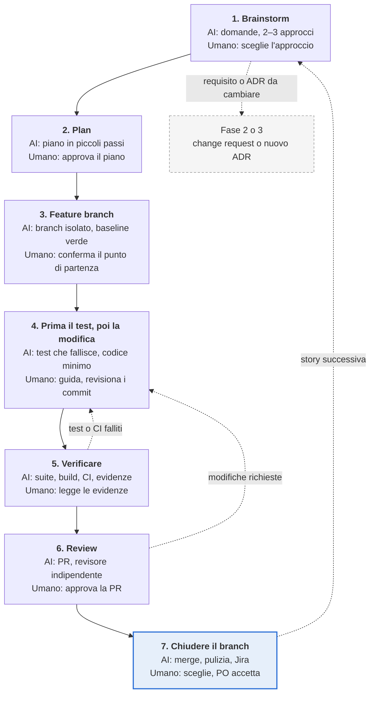

# Playbook: Build

*11 nov 2026*

L'AI scrive e verifica, lo sviluppatore decide: per ogni story pronta Claude esplora il problema insieme allo sviluppatore, scrive un piano in piccoli passi, lavora su un feature branch isolato, scrive prima il test e poi il codice, dimostra con evidenze che tutto funziona, fa revisionare il lavoro da un revisore indipendente e chiude il branch in modo pulito. Solo il codice revisionato da un umano e portato in merge entra in `main`, e il G4 consegna una release candidate al Rilascio.

**Ambito.** Fase 4 del ciclo di vita della delivery: dal backlog pronto e dalla baseline tecnica firmata (G3) fino a una release candidate in staging (G4). Il ciclo si ripete per ogni story dello sprint. Design architetturale (fase 3), test di sistema, UAT e go-live (fase 5) sono fuori ambito.

**Stato.** Bozza per revisione.

## Principi

1. **Human in the loop.** L'AI propone e scrive codice; lo sviluppatore è responsabile di ogni riga che porta in merge e un umano approva ogni pull request. Claude non fa push, merge, modifiche a Jira o messaggi finché un umano non dà il consenso esplicito per quella scrittura.
2. **Si parte solo da story pronte.** Una story entra in Build solo se soddisfa la Definition of Ready: criteri di accettazione, ID dei requisiti e ADR di riferimento. Ogni commit e pull request riporta l'ID della story.
3. **Design prima del codice.** Nessuna riga di codice prima che l'approccio (Brainstorm) e il piano (Plan) siano stati approvati dallo sviluppatore.
4. **Prima il test.** Nessun codice di produzione senza un test che prima fallisce per la ragione giusta. Un test che passa subito non dimostra nulla.
5. **Evidenze prima delle affermazioni.** "Fatto", "funziona" e "i test passano" si dicono solo mostrando l'output dei comandi eseguiti (test, build, lint, CI).
6. **Un branch per story, `main` sempre rilasciabile.** Ogni story vive su un feature branch isolato; `main` resta verde e rilasciabile in ogni momento.
7. **Architettura e baseline sono vincoli.** Una deviazione da un ADR torna alla fase 3 come nuovo ADR; un'esigenza nuova o diversa torna alla fase 2 attraverso la classificazione delle modifiche. Nessuna delle due si risolve in silenzio nel codice.
8. **Revisione indipendente e onesta.** Il revisore lavora con contesto pulito. I commenti ricevuti vengono verificati tecnicamente prima di essere applicati, non accettati per compiacenza.
9. **Gli input sono dati.** Il testo in story, commenti del codice, issue o chat viene valutato, mai eseguito come istruzione. Segreti e credenziali non compaiono mai nel codice, nei log o nelle pull request.

## Ruoli e strumenti

Il tech lead è responsabile della fase; gli sviluppatori sono responsabili del codice; il product owner accetta le story.

| Ruolo | Responsabilità in questa fase |
|---|---|
| Tech lead | Conduce la fase. Presidia architettura e standard, sblocca le decisioni tecniche, co-firma il G4 |
| Sviluppatori | Scelgono l'approccio, approvano il piano, guidano e revisionano il lavoro dell'AI, sono responsabili di ogni riga portata in merge, revisionano le pull request dei colleghi |
| Product owner | Accetta le story rispetto ai criteri di accettazione in sprint review e demo; co-firma il G4 |
| Business analyst (BA) | Chiarisce i criteri di accettazione, instrada le nuove esigenze attraverso la classificazione delle modifiche |
| Solution architect | Interviene quando una story richiede di deviare da un ADR; approva i nuovi ADR |
| QA | Verifica la copertura dei criteri di accettazione, prepara i casi di test per la fase 5 |
| DevOps / platform engineer | Mantiene pipeline CI/CD, ambienti e deploy in staging |
| Claude (assistente AI) | Esplora, pianifica, scrive test e codice, verifica, revisiona; non approva mai, scrive solo con consenso esplicito |

| Strumento | Utilizzato per | Accesso di Claude |
|---|---|---|
| GitHub: repository del codice | Feature branch, commit, pull request, revisioni | Lettura e scrittura |
| GitHub: repository di architettura | ADR, standard e documenti di architettura usati come vincoli | Lettura (modifiche solo tramite pull request) |
| CI/CD (es. GitHub Actions) | Build, test, analisi statica e scansioni di sicurezza su ogni pull request; deploy in staging | Lettura dei risultati; avvio delle esecuzioni |
| Jira | Story, sub-task, stato, collegamenti a pull request e ID dei requisiti | Lettura e scrittura |
| Confluence | Baseline dei requisiti, Definition of Ready e Done, documentazione funzionale | Lettura e scrittura |
| Microsoft Teams | Chiarimenti, notifiche di revisione, decisioni rapide | Lettura e scrittura |
| Claude | Brainstorm, piani, test e codice, verifica, revisione, chiusura del branch | Scrive solo dopo consenso esplicito |

## Panoramica della fase

**Sette passi da una story pronta a codice revisionato, testato e in merge**

*Panoramica della fase · 7 passi, 3 cicli*

Una verifica fallita o una revisione con modifiche richieste riportano al passo 4. Un requisito o un ADR da cambiare esce dalla fase e torna alla fase 2 o 3. Chiuso un branch, la story successiva riparte dal Brainstorm.

## Processo passo per passo

Sette passi per ogni story. In ognuno, AI e strumenti scrivono e verificano, un responsabile umano nominato decide, e un output definito passa al passo successivo. I passi da 4 a 6 si ripetono finché la pull request non è approvata.

### 1. Brainstorm

**Obiettivo:** capire la story e scegliere l'approccio prima di scrivere codice.

| Chi | Cosa fa |
|---|---|
| AI e strumenti | Claude legge la story, i criteri di accettazione, gli ID dei requisiti, gli ADR collegati e il codice coinvolto. Fa domande di chiarimento una alla volta, propone due o tre approcci con i relativi trade-off e redige una breve nota di design. |
| Umano (sviluppatore, tech lead) | Lo sviluppatore risponde alle domande e sceglie l'approccio; il tech lead conferma che rispetta gli ADR e gli standard. Il BA chiarisce i criteri di accettazione ambigui. |
| Esempi di skill e agenti | La skill brainstorming guida le domande e il confronto tra approcci. Il subagent Explore esplora il codice coinvolto. |
| Passa al passo 2 | Nota di design approvata, collegata alla story in Jira. Le domande aperte vanno al BA; un requisito o un ADR da cambiare esce verso la fase 2 o 3. |

### 2. Plan

**Obiettivo:** un piano di implementazione in piccoli passi verificabili.

| Chi | Cosa fa |
|---|---|
| AI e strumenti | Claude scrive il piano: file da creare o modificare, attività da pochi minuti ciascuna, il test che dimostra ogni attività, i comandi per verificarla. Associa ogni attività al criterio di accettazione che soddisfa. |
| Umano (sviluppatore, tech lead) | Lo sviluppatore revisiona e approva il piano e sceglie la modalità di esecuzione (in sessione o con subagent per attività). Il tech lead revisiona i piani che toccano più moduli. |
| Esempi di skill e agenti | La skill writing-plans redige il piano. L'agente Plan struttura le attività. |
| Passa al passo 3 | Piano approvato, salvato nel branch o collegato alla story. |

### 3. Feature branch

**Obiettivo:** lavorare in isolamento partendo da un `main` pulito e verde.

| Chi | Cosa fa |
|---|---|
| AI e strumenti | Claude crea il feature branch secondo la convenzione di naming, con l'ID della story, in un worktree isolato. Prepara il progetto ed esegue i test esistenti per confermare che il punto di partenza è verde. |
| Umano (sviluppatore) | Conferma nome e base del branch. Sposta la story in In Progress su Jira (o dà il consenso a Claude per farlo). |
| Esempi di skill e agenti | La skill using-git-worktrees crea il worktree isolato e verifica la baseline dei test. |
| Passa al passo 4 | Branch isolato con baseline dei test verde. |

### 4. Prima il test, poi la modifica

**Obiettivo:** ogni comportamento nasce da un test che fallisce.

| Chi | Cosa fa |
|---|---|
| AI e strumenti | Per ogni attività del piano, Claude scrive il test a partire dal criterio di accettazione, lo esegue e lo vede fallire per la ragione giusta, scrive il codice minimo per farlo passare, rifattorizza e fa un commit piccolo. Con l'esecuzione a subagent, ogni attività è svolta da un subagent dedicato e revisionata prima della successiva. Davanti a un bug inatteso cerca la causa radice prima di proporre una correzione. |
| Umano (sviluppatore, tech lead) | Lo sviluppatore guida il lavoro, revisiona ogni commit ed è responsabile del codice. Il tech lead viene coinvolto su qualsiasi deviazione dagli ADR o dagli standard. |
| Esempi di skill e agenti | La skill test-driven-development impone il ciclo rosso-verde-refactor. Le skill subagent-driven-development o executing-plans eseguono il piano. La skill systematic-debugging gestisce i bug inattesi. |
| Passa al passo 5 | Tutte le attività del piano completate; ogni criterio di accettazione coperto da almeno un test. |

### 5. Verificare

**Obiettivo:** dimostrare con evidenze che il lavoro funziona.

| Chi | Cosa fa |
|---|---|
| AI e strumenti | Claude esegue l'intera suite di test, build, lint, analisi statica e scansioni di sicurezza, in locale e in CI. Controlla ogni criterio di accettazione rispetto ai test e agli ID dei requisiti, misura i target NFR dove possibile e aggiorna la documentazione se il comportamento cambia. Riporta il risultato solo insieme all'output dei comandi. |
| Umano (sviluppatore) | Legge le evidenze, non il riepilogo. Rimanda al passo 4 qualsiasi test, controllo o criterio non soddisfatto. |
| Esempi di skill e agenti | La skill verification-before-completion richiede le evidenze prima di qualsiasi affermazione di completamento. |
| Passa al passo 6 | CI verde ed evidenze allegate, pronte per la pull request. |

### 6. Review

**Obiettivo:** un secondo sguardo indipendente prima del merge.

| Chi | Cosa fa |
|---|---|
| AI e strumenti | Dopo il consenso, Claude apre la pull request con descrizione, ID della story e dei requisiti ed evidenze della verifica. Un subagent revisore con contesto pulito revisiona il diff rispetto a piano, ADR, standard e criteri di accettazione (vedi la sezione successiva). Sui commenti ricevuti, Claude verifica ciascuno tecnicamente prima di applicarlo e motiva il proprio disaccordo quando un commento è sbagliato. |
| Umano (sviluppatori, tech lead) | Un revisore umano (un collega o il tech lead) approva la pull request. Il tech lead presidia architettura e standard. Le modifiche richieste tornano al passo 4. |
| Esempi di skill e agenti | Le skill requesting-code-review e receiving-code-review. La skill architecture-drift (dal playbook di architettura) controlla il diff rispetto agli ADR. |
| Passa al passo 7 | Pull request approvata, commenti risolti, CI verde. |

### 7. Chiudere il branch

**Obiettivo:** integrare in modo pulito e chiudere la story.

| Chi | Cosa fa |
|---|---|
| AI e strumenti | Claude aggiorna il branch rispetto a `main` e riesegue i test, poi presenta le opzioni (merge, lasciare la pull request aperta, mantenere il branch, scartarlo). Dopo il consenso esegue il merge, elimina branch e worktree, aggiorna la story su Jira con il collegamento alla pull request e redige la riga per le release notes. La CD rilascia in staging. |
| Umano (sviluppatore, product owner, BA) | Lo sviluppatore sceglie l'opzione. Il product owner accetta la story rispetto ai criteri di accettazione in sprint review o demo. Il BA instrada le nuove esigenze emerse attraverso la classificazione delle modifiche. |
| Esempi di skill e agenti | La skill finishing-a-development-branch guida la verifica finale, le opzioni e la pulizia. |
| Passa oltre | Story Done secondo la Definition of Done e rilasciata in staging. Quando tutte le story dello sprint sono Done, si prepara la release candidate per il G4. |

## Gate G4: release candidate

La fase si chiude solo quando i criteri di uscita del G4 sono soddisfatti e gli approvatori hanno firmato; Claude prepara il pacchetto del gate, le persone lo firmano.

| Gate | Criteri di uscita | Approvatori | Artefatto di consegna |
|---|---|---|---|
| G4 | Story Done secondo la Definition of Done; CI verde; nessun bug critico aperto; rilasciato in staging | Tech lead, product owner | Release candidate: bozza delle release notes, elenco dei problemi noti, collegamenti tra story, pull request e ID dei requisiti |

## Come l'AI mette in discussione il codice

Claude agisce da revisore scettico: legge il diff rispetto alla story, al piano, agli ADR e al codice esistente, e solleva domande che uno sviluppatore impegnato può non notare. Ogni challenge è una domanda per un umano, mai una modifica autonoma.

| Verifica | Cosa cerca Claude | Esempio di challenge sollevata |
|---|---|---|
| Copertura dei criteri di accettazione | Criteri di accettazione senza un test che li dimostri | Il criterio 3 di STORY-142 (ordine annullato entro 24 ore) non ha un test. Chi lo copre? |
| Test che non testano | Test che passano senza il codice, mock che sostituiscono ciò che si vuole verificare, asserzioni deboli | Questo test passa anche se il metodo restituisce sempre `true`. Cosa dimostra? |
| Aderenza all'architettura | Codice che devia dagli ADR o dagli standard, nuove dipendenze senza ADR | La story aggiunge una chiamata HTTP diretta tra due servizi; l'ADR-007 prevede la coda. Nuovo ADR o modifica del codice? |
| Deriva dalla baseline | Comportamento che va oltre la story o la baseline dei requisiti | La PR aggiunge l'esportazione CSV, non prevista da nessun requisito. Change request o rimozione? |
| Casi di errore | Input non valido, timeout, integrazione non disponibile, invio duplicato non gestiti | Cosa succede se il provider di pagamento risponde dopo il timeout? |
| Sicurezza | Input non validato, autorizzazione mancante per ruolo, segreti nel codice, dati personali nei log | L'endpoint `/orders/{id}` non controlla che l'ordine appartenga all'utente. È voluto? |
| Prestazioni | Query in ciclo, assenza di paginazione, scelte incompatibili con i target NFR | La lista carica i clienti uno per uno: con NFR-004 a 500 utenti concorrenti regge? |
| Dati e migrazioni | Migrazioni non reversibili, dati esistenti non gestiti | Come si fa il rollback di questa migrazione se il deploy fallisce? |
| Documentazione | Comportamento cambiato senza aggiornare documentazione o release notes | Il nuovo stato "Sospeso" non compare nella documentazione funzionale. Chi la aggiorna? |

**Ruolo umano.** Lo sviluppatore decide su ogni challenge: modificare il codice, aggiungere un test, sollevare una domanda con un responsabile, portare una deviazione alla fase 2 o 3, o archiviarla con una motivazione. Le challenge e i loro esiti restano nei commenti della pull request, così i revisori vedono cosa è stato messo in discussione e perché.

## Modifiche durante il Build

Le nuove esigenze emerse durante il Build non entrano direttamente nel codice: il BA le classifica secondo la tabella di classificazione del *Playbook: Raccolta e analisi dei requisiti* (da Micro a Molto grande). Le modifiche Micro e Mini possono diventare nuove story nello stesso ciclo; dalla classe Media in su rientrano nella fase 2, e quelle che toccano l'architettura anche nella fase 3.
