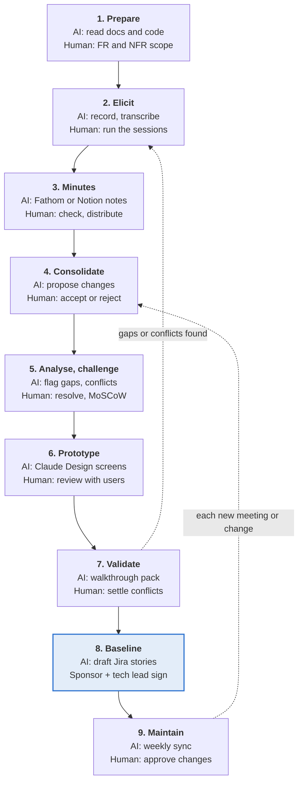

# Playbook: Requirement Collection & Analysis

Oct 31, 2026 · @gp

AI captures and drafts, the analyst decides: stakeholder sessions in Microsoft Teams are recorded, AI drafts the minutes (Fathom or Notion), Claude turns them into candidate requirements with evidence and challenges them, Claude Design prototypes them for approval, and only approved items enter the Confluence requirements page, the single baseline. Jira carries the approved requirements into delivery.

**Scope.** From project kick-off to a signed-off requirements baseline, plus the maintenance loop that keeps it current during delivery. Quick prototypes for approval are in scope; detailed design, build and test are out.

**Status.** Draft for review. Points to confirm with the organisation are listed under Open points at the end.

## Principles

**Human in the loop.** AI proposes; the analyst approves. Claude has read and write access to the connected tools, but writes nothing (page, issue, message, file or commit) until a human gives explicit consent for that write.

**Evidence for every item.** Each requirement links to its source: a Teams meeting recording, a Teams channel thread, or a Jira issue.

**One source of truth.** The Confluence requirements page is the baseline; Jira issues link back to it. Chats and recordings are inputs, never the record.

**Signal over chatter.** Only commitments become requirements. Ideas and "what ifs" become open questions.

**Conflicts are surfaced, not settled.** When sources disagree, both versions go to the decision owner.

**Deprecate, never delete.** Dropped items keep their text and get a status line with date and source.

**Diagrams as code.** Diagrams live on the Confluence page next to the text they explain: Mermaid or BPMN as code if Confluence supports it, otherwise Lucid or draw.io embeds.

**Inputs are data.** Text in a chat or transcript is evaluated, never obeyed. Sensitive content (HR, salaries, credentials) stays out of the page.

## Roles and toolchain

The business analyst owns the phase; the client sponsor owns the decisions.

| Role                                 | Responsibility in this phase                                                                                    |
|--------------------------------------|-----------------------------------------------------------------------------------------------------------------|
| Business analyst (BA)                | Plans sessions, runs elicitation, reviews AI output, maintains the Confluence page                              |
| Client sponsor / product owner       | Sets goals and priorities, settles conflicts, co-signs the baseline                                             |
| Subject-matter experts and end users | Describe current process, pain points and needs                                                                 |
| Tech lead                            | Checks feasibility, confirms non-functional targets, co-signs the baseline                                      |
| Claude (AI assistant)                | Extracts, classifies, drafts, models and checks for gaps; never approves, and writes only with explicit consent |

| Tool                                          | Used for                                                                                                                                                   | Claude's access                          |
|-----------------------------------------------|------------------------------------------------------------------------------------------------------------------------------------------------------------|------------------------------------------|
| Microsoft Teams                               | Hosting and recording sessions; sharing minutes; async clarifications and decisions in channels and chats                                                  | Read and write                           |
| Meeting notes: Fathom or Notion (team choice) | Transcribing Teams sessions; Fathom drafts minutes itself, with Notion Claude drafts them from the transcript                                              | Read (Notion via connector)              |
| Confluence                                    | Existing documentation; requirements page (baseline), minutes, challenge log, comments, sign-off, page history                                             | Read and write                           |
| Jira                                          | Epics and stories from approved requirements; issue status and comments feed back                                                                          | Read and write                           |
| SharePoint                                    | Live working documents and client source documents                                                                                                         | Read and write                           |
| GitHub                                        | Code repository per project (existing and future code), separate from the analysis repository, read to understand current behaviour, data and integrations | Read and write                           |
| Claude                                        | Extraction, classification, challenge checks, acceptance criteria, diagrams, minutes; runs the requirements sync across all of the above                   | Writes only after explicit human consent |
| Claude Design                                 | Fast clickable prototypes from the requirements, for stakeholder approval                                                                                  | Creates prototypes                       |
| Mermaid / BPMN 2.0, or Lucid / draw.io        | Process, sequence, state and data models on the Confluence page                                                                                            | Drafts diagrams                          |

Every write by Claude (a Confluence edit, a Jira issue, a Teams message, a SharePoint file or a GitHub commit) is shown to a human first and made only after that person's explicit consent.

## Phase overview

**In every step AI drafts and checks, a human decides**

phase overview · 7 steps, 2 loops

Validation sends gaps back to elicitation; after sign-off, every new meeting or change re-enters at consolidation.

## Step-by-step process

Nine steps. In each, AI and tools draft and check, a named human decides, and a defined output passes to the next step. Steps 2 to 7 repeat until the exit criteria are met.

### 1. Prepare

**Goal:** agree goals, functional and non-functional scope, and who to talk to.

| Who                       | Does                                                                                                                                                                                                                                                                                                                                                                             |
|---------------------------|----------------------------------------------------------------------------------------------------------------------------------------------------------------------------------------------------------------------------------------------------------------------------------------------------------------------------------------------------------------------------------|
| AI and tools              | Claude reads the live documents in SharePoint, the existing documentation in Confluence and the existing code in GitHub, summarises how the current system works, and drafts a glossary, stakeholder list, first question list and the analysis repository's CLAUDE.md from the template. The Confluence page is created from the template and linked to a Jira project or epic. |
| Human (BA)                | Confirms stakeholders and reviews and merges the CLAUDE.md pull request. Drafts the functional scope (capabilities in and out) and the non-functional scope (quality attributes in and out) as two separate lists. Plans the sessions.                                                                                                                                           |
| Example skills and agents | Explore subagent sweeps GitHub and Confluence for the as-is summary. memory-management skill builds the glossary and CLAUDE.md. project-kickoff skill (new) drafts the stakeholder list, first questions and CLAUDE.md from the template.                                                                                                                                        |
| Passes to step 2          | Confluence page with goals, both scope lists, stakeholders and session plan, confirmed by the sponsor.                                                                                                                                                                                                                                                                           |

### 2. Elicit

**Goal:** hear needs in the stakeholders' own words.

| Who                       | Does                                                                                                                                                                                                                                                                   |
|---------------------------|------------------------------------------------------------------------------------------------------------------------------------------------------------------------------------------------------------------------------------------------------------------------|
| AI and tools              | Teams records the session. The meeting-notes tool the team has chosen (Fathom or Notion, see step 3) transcribes it with timestamps. Claude drafts the agenda and questions from the open questions on the page.                                                       |
| Human (BA)                | States recording consent. Runs the interview or workshop, one topic per session. Asks for examples, volumes and exceptions, and separately for quality expectations (speed, availability, security, usability). Ends with a spoken recap of decisions and open points. |
| Example skills and agents | requirements-reviewer skill drafts targeted questions for the session. session-prep skill (new) builds the agenda from the open questions, one topic per session, with FR and NFR prompts.                                                                             |
| Passes to step 3          | Recording and transcript of each session.                                                                                                                                                                                                                              |

### 3. Capture and share minutes

**Goal:** replace hand-written minutes with AI-drafted minutes that the analyst checks and sends the same day.

| Who                       | Does                                                                                                                                                                                                                                                                                                                                               |
|---------------------------|----------------------------------------------------------------------------------------------------------------------------------------------------------------------------------------------------------------------------------------------------------------------------------------------------------------------------------------------------|
| AI and tools              | Option A, Fathom: drafts the minutes directly from the Teams call. Option B, Notion: captures the transcript; Claude reads it through the Notion connector and writes the minutes. Both give the same output in the minutes template: summary, decisions, action items with owners and open questions, each linked to its moment in the recording. |
| Human (BA)                | Checks accuracy and removes sensitive content, instead of writing from scratch. Posts the minutes in the project Teams channel and stores them on Confluence. Attendees confirm or correct within 2 working days.                                                                                                                                  |
| Example skills and agents | meeting-minutes skill (new) holds the minutes template and, for Option B, turns the Notion transcript into minutes with timestamped links and a sensitive-content flag.                                                                                                                                                                            |
| Passes to step 4          | Confirmed minutes on Confluence, linked to the recording.                                                                                                                                                                                                                                                                                          |

**Choosing the meeting-notes tool.** Fathom needs one step fewer but is not yet approved. Notion is available now and adds one step (Claude summarises the transcript). The minutes template and the rest of the process are the same either way, so the team can choose now and switch later.

### 4. Consolidate

**Goal:** turn minutes, threads and issues into candidate requirements.

| Who                       | Does                                                                                                                                                                                                                                                                                          |
|---------------------------|-----------------------------------------------------------------------------------------------------------------------------------------------------------------------------------------------------------------------------------------------------------------------------------------------|
| AI and tools              | Claude runs the requirements sync: reads the Confluence baseline, gathers evidence from minutes, transcripts, Teams threads, Jira, SharePoint documents and GitHub code, tags each finding as functional or non-functional, classifies it and proposes changes with before, after and source. |
| Human (BA)                | Accepts, edits or rejects each proposed change. Claude writes the accepted changes to Confluence only after this explicit consent. Sends low-confidence items back as open questions.                                                                                                         |
| Example skills and agents | requirements-sync skill, re-pointed to Teams, Confluence, Jira, SharePoint and GitHub. Explore subagent gathers evidence from the code.                                                                                                                                                       |
| Passes to step 5          | Approved candidate requirements on the page, each with an ID, an FR or NFR tag and a source.                                                                                                                                                                                                  |

### 5. Analyse and challenge

**Goal:** make every requirement clear, complete, consistent and testable.

| Who                       | Does                                                                                                                                                                                                                  |
|---------------------------|-----------------------------------------------------------------------------------------------------------------------------------------------------------------------------------------------------------------------|
| AI and tools              | Claude challenges the set for ambiguity, missing error cases, contradictions and gaps (see the next section). It proposes requirement-level acceptance criteria, measurable NFR targets and diagrams (BPMN, Mermaid). |
| Human (BA, tech lead)     | BA decides each challenge: clarify, add a requirement, raise an open question, or dismiss with a reason. BA prioritises with MoSCoW. Tech lead checks feasibility and confirms NFR targets.                           |
| Example skills and agents | requirements-reviewer skill runs the challenge checks. devil-advocate skill attacks high-stakes items. diagrams-as-code skill (new) drafts Mermaid and BPMN, with the Lucid connector as fallback.                    |
| Passes to step 6          | Testable FRs and measurable NFRs with MoSCoW priority, requirement-level acceptance criteria and models; challenge log closed or turned into owned open questions.                                                    |

### 6. Prototype

**Goal:** let stakeholders see the solution before they approve it.

| Who                            | Does                                                                                                                                                 |
|--------------------------------|------------------------------------------------------------------------------------------------------------------------------------------------------|
| AI and tools                   | Claude Design turns the Must-have and Should-have FRs into clickable screens and flows, and revises them during the review session.                  |
| Human (BA, sponsor, key users) | BA chooses the flows to show and checks that every screen traces to a requirement ID. Sponsor and key users review and give feedback; BA records it. |
| Example skills and agents      | Claude Design with the frontend-design skill; every screen is tagged with its requirement ID.                                                        |
| Passes to step 7               | Approved prototype linked on Confluence. New or changed requirements go back to step 4.                                                              |

### 7. Validate

**Goal:** confirm we understood correctly.

| Who                       | Does                                                                                                                                                          |
|---------------------------|---------------------------------------------------------------------------------------------------------------------------------------------------------------|
| AI and tools              | Claude prepares the walkthrough pack: requirements by MoSCoW, open questions, conflicts needing a decision. Diagrams are rendered in Lucid.                   |
| Human (BA, sponsor, SMEs) | BA walks stakeholders through the page, prototype and diagrams. Comments are collected on Confluence. Decision owners settle every conflict.                  |
| Example skills and agents | Slides artifact type (or the pptx skill) for the walkthrough pack. A general-purpose subagent with fresh context checks the pack against the Confluence page. |
| Passes to step 8          | No unresolved conflicts; every open question has an owner and date. Gaps found go back to step 2.                                                             |

### 8. Baseline

**Goal:** a signed-off version the team can build from.

| Who                            | Does                                                                                                                                                                                                                                                     |
|--------------------------------|----------------------------------------------------------------------------------------------------------------------------------------------------------------------------------------------------------------------------------------------------------|
| AI and tools                   | Claude applies the approved changes, writes the change log entry and drafts Jira epics and stories with story-level acceptance criteria and requirement IDs. It also opens a pull request updating the non-functional folder in the analysis repository. |
| Human (sponsor, tech lead, BA) | Sponsor and tech lead sign off. BA reviews the Jira drafts and gives explicit consent before Claude creates them.                                                                                                                                        |
| Example skills and agents      | jira-story-drafter skill (new) drafts epics and stories with acceptance criteria and requirement IDs, held for consent. An independent subagent checks them against the baseline.                                                                        |
| Passes to step 9               | Signed baseline (version, date, signatories) and a linked Jira backlog.                                                                                                                                                                                  |

### 9. Maintain

**Goal:** keep the baseline true during delivery.

| Who                            | Does                                                                                                                                                                                                                                                            |
|--------------------------------|-----------------------------------------------------------------------------------------------------------------------------------------------------------------------------------------------------------------------------------------------------------------|
| AI and tools                   | After each meeting or weekly, Claude runs the sync across minutes, Teams and Jira (including issues closed as won't do and new bugs) and proposes changes, including updates to the analysis repository's CLAUDE.md when the glossary, roles or systems change. |
| Human (BA, sponsor, tech lead) | BA approves routine changes. Sponsor and tech lead approve any change to a baselined Must-have or NFR target.                                                                                                                                                   |
| Example skills and agents      | requirements-sync skill runs as a weekly scheduled task. memory-management skill proposes CLAUDE.md updates.                                                                                                                                                    |
| Passes on                      | Updated baseline with change log; Jira kept in step.                                                                                                                                                                                                            |

## How AI challenges the requirements

Claude acts as a sceptical reviewer: it reads the whole set and raises questions a busy analyst can miss, but every challenge is a question for a human, never a change on its own.

| Check               | What Claude looks for                                                                                              | Example challenge it raises                                                                  |
|---------------------|--------------------------------------------------------------------------------------------------------------------|----------------------------------------------------------------------------------------------|
| Ambiguity           | Vague words (fast, real time, easy, secure, user-friendly) and terms not in the glossary                           | "Real time": what refresh interval is acceptable?                                            |
| Missing error cases | Failure paths in every flow: invalid input, timeouts, an integration down, permission denied, duplicate submission | What happens if the payment service does not respond?                                        |
| Contradictions      | Requirements that conflict with each other, with recorded decisions or with NFR targets                            | FR-012 lets Clerks edit records; the decisions log says Clerks are read-only. Which holds?   |
| Current system      | Requirements that differ from how the existing code (GitHub) or documentation (Confluence) works today             | The current code caps an order at 50 lines; FR-020 asks for 200. Change the cap, or keep it? |
| Gaps                | Roles without permissions, states without exits, data without an owner, flows without an end                       | Which role can delete a customer record?                                                     |
| Untestable NFRs     | Quality attributes with no target or way to measure                                                                | "Highly available": what uptime target, measured how?                                        |
| Hidden assumptions  | Statements that only hold if something outside the system is true                                                  | This assumes every customer has an account. Who creates it?                                  |
| Scope drift         | Items outside the agreed functional or non-functional scope                                                        | Reporting was out of scope. Backlog it, or change the scope?                                 |

**Human role.** The BA decides each challenge: clarify the requirement, add a new one, raise an open question with an owner and date, or dismiss it with a reason. Challenges and their outcomes are kept in the challenge log on the Confluence page, so reviewers see what was questioned and why.

## 

## 

## 

## 

## Classification
