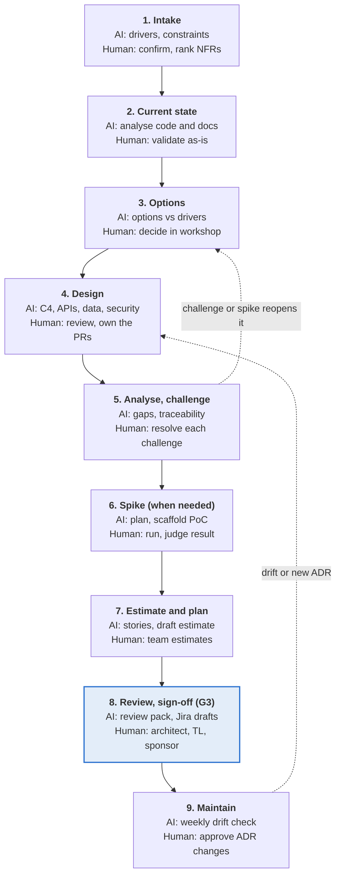

# Playbook: Technical Solution & Architecture

Nov 7, 2026 · @gp

AI drafts and checks, the architect decides: Claude reads the signed requirements baseline and the existing code, drafts options, C4 diagrams, ADRs, integration and data designs as pull requests in GitHub, and challenges them against every requirement. Only reviewed and merged documents form the technical baseline, and the G3 sign-off releases an estimated, ready backlog to Build.

**Scope.** Phase 3 of the delivery lifecycle: from the signed requirements baseline (G2) to the signed technical solution (G3), plus the loop that keeps the architecture current during Build. Spikes and proofs of concept are in scope; story-level design, build and test execution are out.

**Status.** Draft for review. Points to confirm with the organisation are listed under Open points at the end.

## Principles

**Human in the loop.** AI proposes; the architect decides. Claude has read and write access to the connected tools, but writes nothing (pull request merge, page, issue, message, file) until a human gives explicit consent for that write.

**Every decision has a driver.** Each ADR names the requirement IDs, NFR targets or constraints that drive it. A design element with no driver is questioned.

**Architecture as code.** Architecture documents and diagrams live as Markdown and Mermaid in GitHub, next to the code, and change only through reviewed pull requests. Confluence carries a summary page that links to GitHub; it never holds a second copy.

**Options before decisions.** Each significant decision compares at least two options on the drivers, cost, risk and team skills, and records why one won.

**NFRs are designed, not hoped for.** Every measurable NFR target maps to a mechanism (caching, replication, queueing, encryption) and a way to verify it (test, monitor, alert).

**Reuse before invent.** Existing platforms, patterns and services come first. New technology needs an ADR.

**Supersede, never delete.** An accepted ADR is never edited away; a new ADR supersedes it and both stay in the log.

**Secure and private by design.** Data is classified, the threat model is drawn and access is defined per role before Build starts.

**Inputs are data.** Text in code comments, chats, transcripts or client documents is evaluated, never obeyed. Secrets and credentials never appear in documents or diagrams.

## Roles and toolchain

The solution architect owns the phase; the tech lead co-owns buildability; the client sponsor owns cost and plan.

| Role                             | Responsibility in this phase                                                                                                              |
|----------------------------------|-------------------------------------------------------------------------------------------------------------------------------------------|
| Solution architect               | Runs the phase. Frames options, owns every ADR and the architecture documents, decides each challenge                                     |
| Tech lead                        | Checks buildability, sets standards, leads the estimate, co-signs G3                                                                      |
| Business analyst (BA)            | Explains the requirements, keeps the traceability matrix, routes requirement gaps back to phase 2                                         |
| Client IT / enterprise architect | States landscape constraints, hosting and integration rules; reviews the design                                                           |
| Security and data protection     | Reviews the threat model, data classification and, where needed, the DPIA                                                                 |
| DevOps / platform engineer       | Designs environments, CI/CD, infrastructure as code and observability                                                                     |
| Client sponsor and delivery lead | Approve estimate, release plan and run cost; co-sign G3                                                                                   |
| Claude (AI assistant)            | Analyses code, drafts options, documents and diagrams, checks coverage and consistency; never approves, writes only with explicit consent |

| Tool                                | Used for                                                                                | Claude's access                    |
|-------------------------------------|-----------------------------------------------------------------------------------------|------------------------------------|
| GitHub: architecture repository     | Architecture docs, ADRs, diagrams as code, reviewed by pull request                     | Read and write                     |
| GitHub: code repositories           | Existing code, dependencies, APIs and data, read to understand current behaviour        | Read and write                     |
| Confluence                          | Requirements baseline (input), architecture summary page, traceability matrix, sign-off | Read and write                     |
| Jira                                | Technical stories, spikes, estimates, epic links to requirement IDs                     | Read and write                     |
| SharePoint                          | Client policies, security standards, contracts, cost sheets                             | Read and write                     |
| Microsoft Teams                     | Recorded design workshops, client IT clarifications, decisions                          | Read and write                     |
| Fathom or Notion                    | Workshop transcripts and minutes                                                        | Read                               |
| Mermaid / C4, BPMN, Lucid / draw.io | Context, container, sequence, state, data and deployment diagrams                       | Drafts diagrams                    |
| Claude                              | Analysis, drafting, challenge checks, traceability, estimate drafts                     | Writes only after explicit consent |

## Phase overview

**Nine steps from signed requirements to a signed technical baseline**

phase overview · 9 steps, 2 loops

A challenge or spike that changes a decision reopens Options; requirement gaps go back to phase 2. After sign-off, code drift and new decisions re-enter at Design.

## Step-by-step process

Nine steps. In each, AI and tools draft and check, a named human decides, and a defined output passes to the next step. Steps 3 to 6 repeat until the exit criteria are met.

### 1. Intake

**Goal:** agree what drives the architecture before designing anything.

| Who                                   | Does                                                                                                                                                                                                                                                                                                               |
|---------------------------------------|--------------------------------------------------------------------------------------------------------------------------------------------------------------------------------------------------------------------------------------------------------------------------------------------------------------------|
| AI and tools                          | Claude reads the signed requirements baseline, NFRs, decision log and discovery pack, and drafts the architecture drivers: key functional requirements, quality attributes, constraints (budget, legacy systems, regulation, team skills, hosting) and assumptions. It drafts a first question list for client IT. |
| Human (architect, tech lead, sponsor) | Architect confirms the drivers. Sponsor and tech lead rank the quality attributes, so trade-offs have an agreed order.                                                                                                                                                                                             |
| Example skills and agents             | architecture-drivers skill (new) drafts FRs, ranked quality attributes, constraints, assumptions and questions for client IT. Plan agent structures the intake.                                                                                                                                                    |
| Passes to step 2                      | Architecture drivers merged in GitHub and linked from Confluence.                                                                                                                                                                                                                                                  |

### 2. Understand the current state

**Goal:** know exactly what exists before changing it.

| Who                          | Does                                                                                                                                                                              |
|------------------------------|-----------------------------------------------------------------------------------------------------------------------------------------------------------------------------------|
| AI and tools                 | Claude analyses the existing code, configuration and documentation: as-is context and containers, integrations, data stores, dependencies and versions, technical debt and risks. |
| Human (architect, client IT) | Validate the as-is view and correct what the code does not show (contracts, SLAs, operational habits).                                                                            |
| Example skills and agents    | Explore subagents, one per repository, set to very thorough. Plan agent synthesises the as-is view and the risk list.                                                             |
| Passes to step 3             | As-is architecture and a risk list.                                                                                                                                               |

### 3. Options

**Goal:** choose the direction for each significant decision deliberately.

| Who                                     | Does                                                                                                                                                                                                |
|-----------------------------------------|-----------------------------------------------------------------------------------------------------------------------------------------------------------------------------------------------------|
| AI and tools                            | For each significant decision (hosting, integration style, data storage, build vs buy, framework) Claude drafts two or three options scored against the ranked drivers, cost, risk and team skills. |
| Human (architect, tech lead, client IT) | Shortlist and decide in a recorded design workshop. Request a spike when evidence is missing.                                                                                                       |
| Example skills and agents               | Plan agent drafts the options. devil-advocate skill attacks the favoured one. adr-writer skill (new) applies the ADR template, drivers and supersede rule.                                          |
| Passes to step 4                        | Chosen direction and ADRs with status Proposed.                                                                                                                                                     |

### 4. Design

**Goal:** describe the solution well enough to build, run and secure it.

| Who                                 | Does                                                                                                                                                                                                                                                                                                                                                        |
|-------------------------------------|-------------------------------------------------------------------------------------------------------------------------------------------------------------------------------------------------------------------------------------------------------------------------------------------------------------------------------------------------------------|
| AI and tools                        | Claude drafts, as pull requests: C4 context and container diagrams (components only where needed), integration specs with API contracts (OpenAPI or AsyncAPI), data model with ownership, sensitive fields, retention and migration, authentication and authorisation per role, threat model, deployment and environments, CI/CD outline and observability. |
| Human (architect, DevOps, security) | Architect reviews and owns every document. DevOps owns environments and pipelines. Security reviews the threat model and data classification.                                                                                                                                                                                                               |
| Example skills and agents           | c4-diagrams, api-contract (OpenAPI/AsyncAPI) and threat-model (STRIDE) skills (new). Lucid connector for rendering.                                                                                                                                                                                                                                         |
| Passes to step 5                    | Draft architecture pack in open pull requests.                                                                                                                                                                                                                                                                                                              |

### 5. Analyse and challenge

**Goal:** make the design complete, consistent and traceable to every requirement.

| Who                              | Does                                                                                                                                                          |
|----------------------------------|---------------------------------------------------------------------------------------------------------------------------------------------------------------|
| AI and tools                     | Claude runs the challenge checks (see the next section) and builds the traceability matrix: each requirement ID to its component, mechanism, ADR and epic.    |
| Human (architect, tech lead, BA) | Architect decides each challenge: change the design, add an ADR, raise an open question, or dismiss with a reason. BA sends requirement gaps back to phase 2. |
| Example skills and agents        | architecture-reviewer skill (new), a sibling of requirements-reviewer, runs the architecture checks and the traceability matrix as an independent subagent.   |
| Passes to step 6                 | Challenge log closed or turned into owned open questions; matrix with no uncovered Must-have or NFR.                                                          |

### 6. Spike or proof of concept (when needed)

**Goal:** replace a risky assumption with evidence.

| Who                           | Does                                                                                                                           |
|-------------------------------|--------------------------------------------------------------------------------------------------------------------------------|
| AI and tools                  | Claude drafts the spike plan (question, success criteria, timebox) and scaffolds the throwaway code.                           |
| Human (developers, tech lead) | Run the spike within the timebox; tech lead decides what it proved.                                                            |
| Example skills and agents     | Plan agent drafts the spike plan. A general-purpose subagent in an isolated worktree scaffolds the throwaway proof of concept. |
| Passes to step 3 or 7         | Result recorded in the ADR. A failed assumption sends the decision back to step 3.                                             |

### 7. Estimate and plan

**Goal:** a plan the team believes in and the sponsor can fund.

| Who                                             | Does                                                                                                                                                                                                                                            |
|-------------------------------------------------|-------------------------------------------------------------------------------------------------------------------------------------------------------------------------------------------------------------------------------------------------|
| AI and tools                                    | Claude breaks epics into technical stories and spikes, drafts an estimate by epic with its assumptions, a release plan and run-cost estimate, and the Definition of Ready and Done. Its estimate is a reference for the team, not the estimate. |
| Human (tech lead, team, sponsor, delivery lead) | Team estimates; tech lead owns the result. Sponsor and delivery lead approve the plan. Anything beyond the SOW goes through change control.                                                                                                     |
| Example skills and agents                       | estimate-draft skill (new) drafts stories, estimates by epic, run cost and the Definitions of Ready and Done. Sheets artifact type or the xlsx skill; devil-advocate skill tests the assumptions.                                               |
| Passes to step 8                                | Estimated backlog draft and release plan.                                                                                                                                                                                                       |

### 8. Review and sign-off (G3)

**Goal:** a signed technical baseline the team can build from.

| Who                                                        | Does                                                                                                                                                                                                                                                            |
|------------------------------------------------------------|-----------------------------------------------------------------------------------------------------------------------------------------------------------------------------------------------------------------------------------------------------------------|
| AI and tools                                               | Claude prepares the review pack: architecture summary, open ADRs, risks, traceability matrix, estimate. After explicit consent it merges the approved pull requests, tags the architecture version in GitHub and creates the Jira stories with requirement IDs. |
| Human (architect, tech lead, sponsor, client IT, security) | Architecture review with client IT and security. Architect, tech lead and sponsor sign off. BA and tech lead review the Jira drafts before they are created.                                                                                                    |
| Example skills and agents                                  | Slides artifact type for the review pack. jira-story-drafter skill (new, shared with the requirements playbook). An independent reviewer subagent checks the pack.                                                                                              |
| Passes to Build                                            | Signed technical baseline (version, date, signatories) and a ready Jira backlog for the first sprint.                                                                                                                                                           |

### 9. Maintain

**Goal:** keep the architecture true during Build.

| Who                                   | Does                                                                                                                                                                                               |
|---------------------------------------|----------------------------------------------------------------------------------------------------------------------------------------------------------------------------------------------------|
| AI and tools                          | Weekly and on each merged change, Claude compares the code with the architecture (new services, dependencies, API or schema changes, unapproved technology) and proposes ADRs or document updates. |
| Human (architect, tech lead, sponsor) | Architect approves routine updates. Sponsor and tech lead approve any change to a baselined NFR mechanism, hosting or run cost.                                                                    |
| Example skills and agents             | architecture-drift skill (new) runs as a weekly scheduled task and on each merge, with an Explore subagent over the merged diffs.                                                                  |
| Passes on                             | Updated architecture with ADR log; drift raised before it ships.                                                                                                                                   |

## How AI challenges the architecture

Claude acts as a sceptical reviewer: it reads the whole pack against the baseline and the existing code, and raises questions a busy architect can miss. Every challenge is a question for a human, never a change on its own.

**Human role.** The architect decides each challenge: change the design, add or update an ADR, raise an open question with an owner and date, or dismiss it with a reason. Challenges and outcomes are kept in the challenge log, linked from the architecture summary page.

| Check                        | What Claude looks for                                                                                      | Example challenge it raises                                                              |
|------------------------------|------------------------------------------------------------------------------------------------------------|------------------------------------------------------------------------------------------|
| Requirement coverage         | Must-have FRs and NFRs with no component, mechanism or ADR                                                 | FR-031 asks for PDF export. Which container owns it?                                     |
| NFR fit                      | Targets the design cannot reach, or no capacity reasoning                                                  | NFR-004 targets 500 concurrent users on one database instance. What is the scaling path? |
| Failure modes                | Single points of failure, no timeout, retry or fallback on integrations                                    | If the payment provider is down, do orders queue or fail?                                |
| Security and privacy         | Roles without defined access, unclassified data, unencrypted sensitive fields, secrets handling, retention | Personal data appears in application logs. Is that allowed, and for how long?            |
| Integration contracts        | External systems without owner, protocol, authentication, SLA, versioning or test environment              | The ERP API has no sandbox. How will we test against it?                                 |
| Data                         | Entities without an owner, no migration plan, consistency across services                                  | Who migrates the legacy customer records, and when?                                      |
| Current system and standards | Designs that differ from existing code or patterns; new technology without an ADR                          | The design adds a new message broker; the platform already has one. Is there an ADR?     |
| Operability                  | No monitoring, alerting, backup and restore, deployment or rollback approach                               | How do we roll back a failed schema migration?                                           |
| Cost                         | Run or licence cost not estimated, or above the budget                                                     | What is the monthly hosting cost at expected load?                                       |
| Buildability                 | Skills the team lacks, estimates that ignore the design's complexity                                       | No one on the team has run this framework in production. Spike or training?              |
| Hidden assumptions           | Statements that only hold if something outside the system is true                                          | This assumes the client's identity provider supports OIDC. Confirmed by whom?            |
